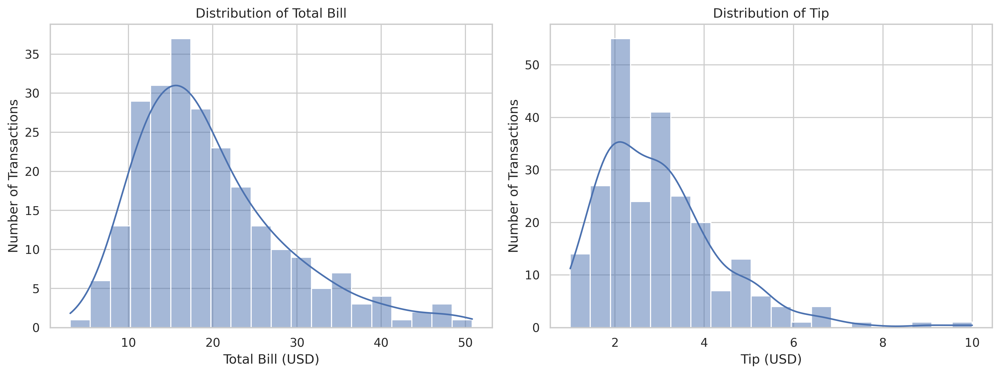
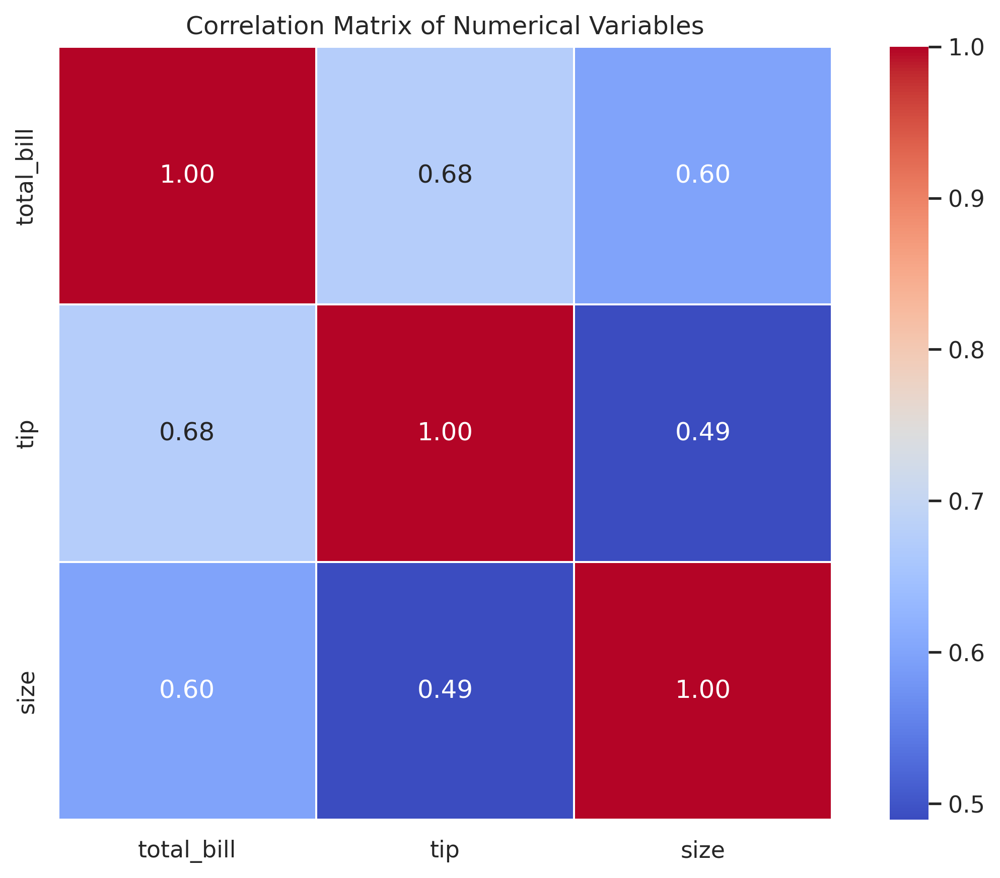
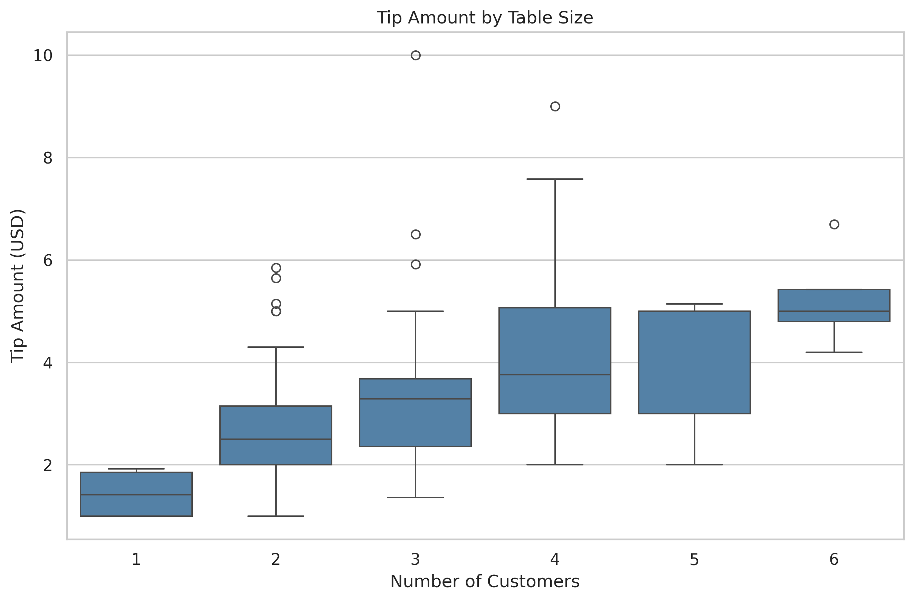
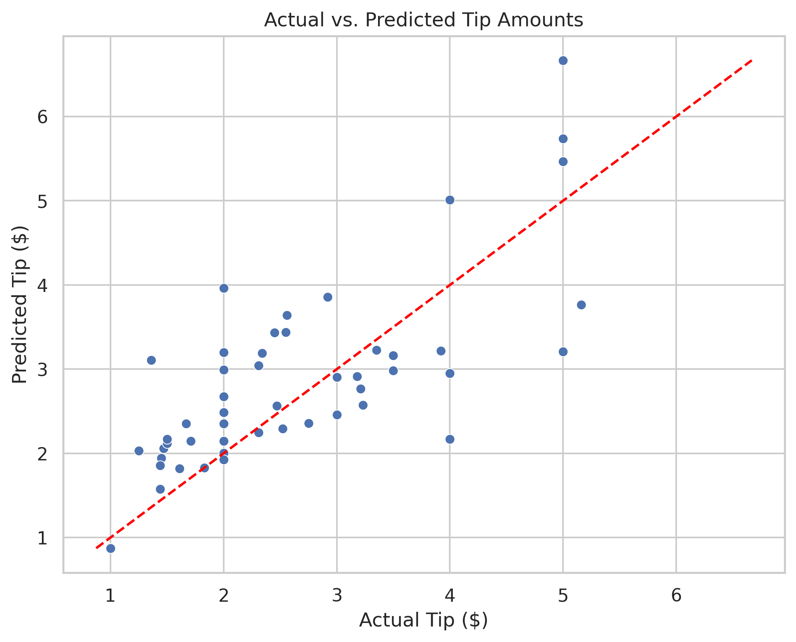
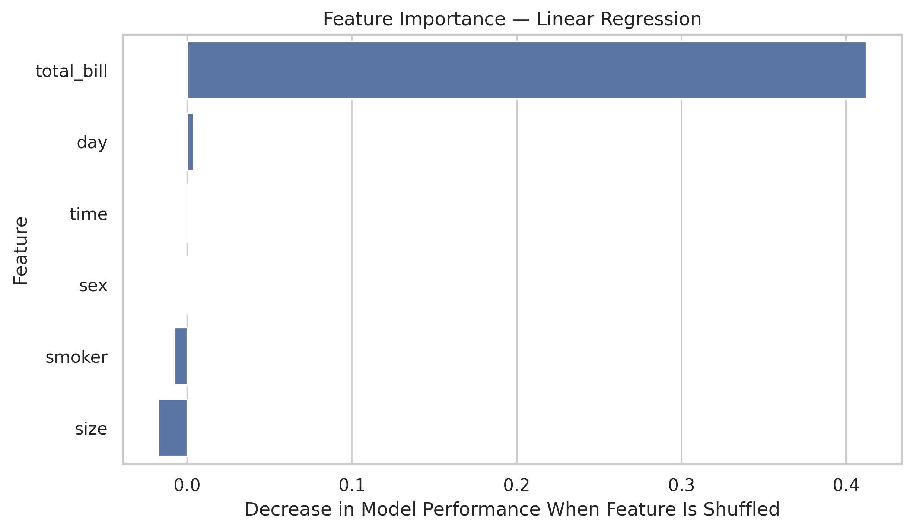

# Restaurant Tips Analysis & Machine Learning

## Project Overview

This project explores restaurant tipping behavior using Python. It applies exploratory data analysis, statistical hypothesis testing, and machine learning to identify factors associated with tip amounts and evaluate their predictive power.

The project focuses on understanding the relationship between restaurant bills and tips, comparing customer and transaction characteristics, and building regression models to predict tip amounts.

## Objectives

- Explore restaurant transaction and tipping patterns.
- Identify relationships between total bill amounts and tips.
- Perform statistical hypothesis testing.
- Build and compare regression models.
- Identify the most influential predictors of tip amounts.

## Dataset

The project uses the restaurant tips dataset, containing **244 observations and 7 variables**.

| Variable | Description |
|---|---|
| `total_bill` | Total restaurant bill |
| `tip` | Tip amount |
| `sex` | Gender category recorded in the dataset |
| `smoker` | Whether the customer was a smoker |
| `day` | Day of the week |
| `time` | Lunch or dinner |
| `size` | Number of people in the dining party |

## Tools & Technologies

- Python
- Pandas and NumPy
- Matplotlib and Seaborn
- SciPy
- Scikit-learn
- Jupyter Notebook

## Project Workflow

### 1. Data Understanding and Cleaning
- Inspected dataset dimensions, data types, and descriptive statistics.
- Checked missing values and duplicate observations.
- Examined potential outliers.

### 2. Exploratory Data Analysis
- Analyzed distributions of bills and tips.
- Examined categorical variables.
- Visualized relationships between total bill and tip.
- Compared tipping patterns across days, dining periods, and customer groups.

### 3. Statistical Analysis
- Pearson correlation
- Welch's independent samples t-test
- One-way ANOVA
- Kruskal-Wallis test

### 4. Machine Learning

This project treats tip prediction as a supervised regression problem.

Three models were evaluated:

- Linear Regression
- Decision Tree Regressor
- Random Forest Regressor

An 80/20 train-test split was used, with `random_state=42`.

### 5. Model Evaluation

Models were compared using Mean Absolute Error (MAE), Root Mean Squared Error (RMSE), and R-squared (R²).

| Model | MAE | RMSE | R² |
|---|---:|---:|---:|
| Linear Regression | **0.667** | **0.839** | **0.437** |
| Decision Tree | 0.697 | 0.883 | 0.376 |
| Random Forest | 0.769 | 0.967 | 0.251 |

Linear Regression achieved the best performance among the evaluated models.

## Key Findings

- Total bill and tip amount have a positive correlation (Pearson r = 0.676, p < 0.001).
- The Welch t-test found no statistically significant difference in average tips between smokers and non-smokers (p = 0.927).
- ANOVA did not find statistically significant differences in mean tips across days (p = 0.174).
- The Kruskal-Wallis test indicated differences in tip distributions across days (p = 0.036).
- Linear Regression performed better than the two tree-based models on the test dataset.
- Permutation importance identified `total_bill` as the dominant predictor of tip amount.

## Limitations

- The dataset contains only 244 observations.
- Model evaluation is based on a single train-test split.
- The dataset does not include factors such as service quality, customer income, or customer satisfaction.
- Statistical associations do not establish causal relationships.
- Further analysis, including cross-validation and post-hoc statistical tests, could improve the robustness of the findings.
## Visualizations

### 1. Bill and Tip Distributions



### 2. Total Bill vs. Tip Relationship


### 3. Correlation Matrix



### 4. Tip Amount by Table Size



### 5. Actual vs. Predicted Tip Amounts



### 6. Feature Importance



## Repository Structure

```text
restaurant-tips-analysis-ml/
│
├── data/
│   └── tips.csv
│
├── notebooks/
│   └── restaurant_tips_analysis.ipynb
│
├── images/
│
├── README.md
├── requirements.txt
├── .gitignore
└── LICENSE
```

## How to Run the Project

1. Clone the repository:

```bash
git clone https://github.com/galkatem02-svg/restaurant-tips-analysis-ml.git
```

2. Navigate to the project directory:

```bash
cd restaurant-tips-analysis-ml
```

3. Install the required packages:

```bash
pip install -r requirements.txt
```

4. Open the Jupyter Notebook:

```bash
jupyter notebook
```

5. Open `notebooks/restaurant_tips_analysis.ipynb` and run the cells.

## Author

**Gauhar Temirgaliyeva**

Data Analysis | Python | SQL | Power BI | Machine Learning

[GitHub Profile](https://github.com/galkatem02-svg)
